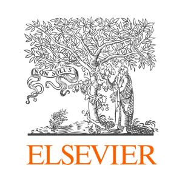

I'm Micaela, a Brazilian/Portuguese engineer living in the charming city of Utrecht, the Netherlands. Having worked in product management and data analysis roles, I like to blend both to create helpful products for users and businesses. I also love to photograph in my free time.

I get energized by...
- ...automating things for other people around me.
- ...uncovering user needs after a round of interviews.
- ...discussing candidate solutions for a business problem.
- ...finding data sources for answering a question.
- ...learning about a new API or spreadsheet integration.
- ...sharing references and interesting reads with others.

    
    

Companies I worked with:

 

    
    

Check out some of <a href="/projects">my projects</a>, or say "Hi!" at <a href="mailto:micaelagparente@gmail.com?Subject=Hi!" target="_top">micaelagparente@gmail.com</a>.
<link href="https://afeld.github.io/emoji-css/emoji.css" rel="stylesheet">
<i class="em em-v"></i>