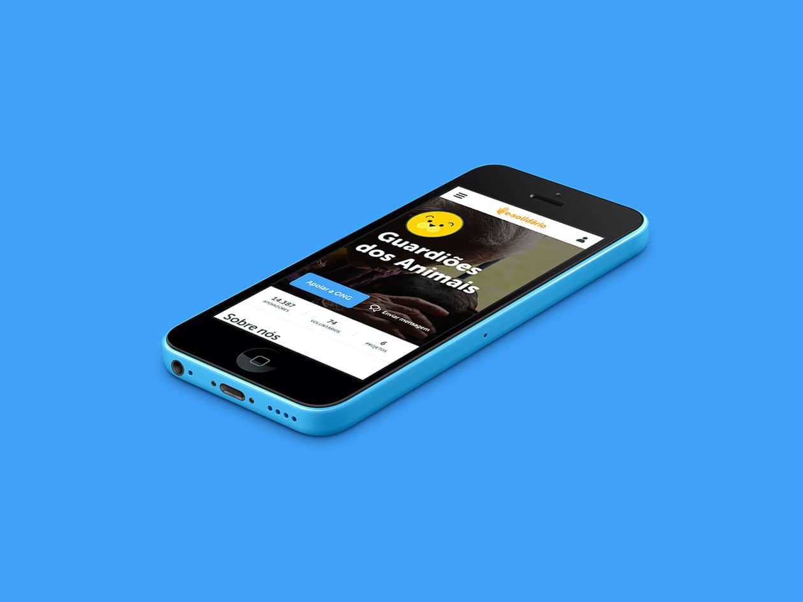
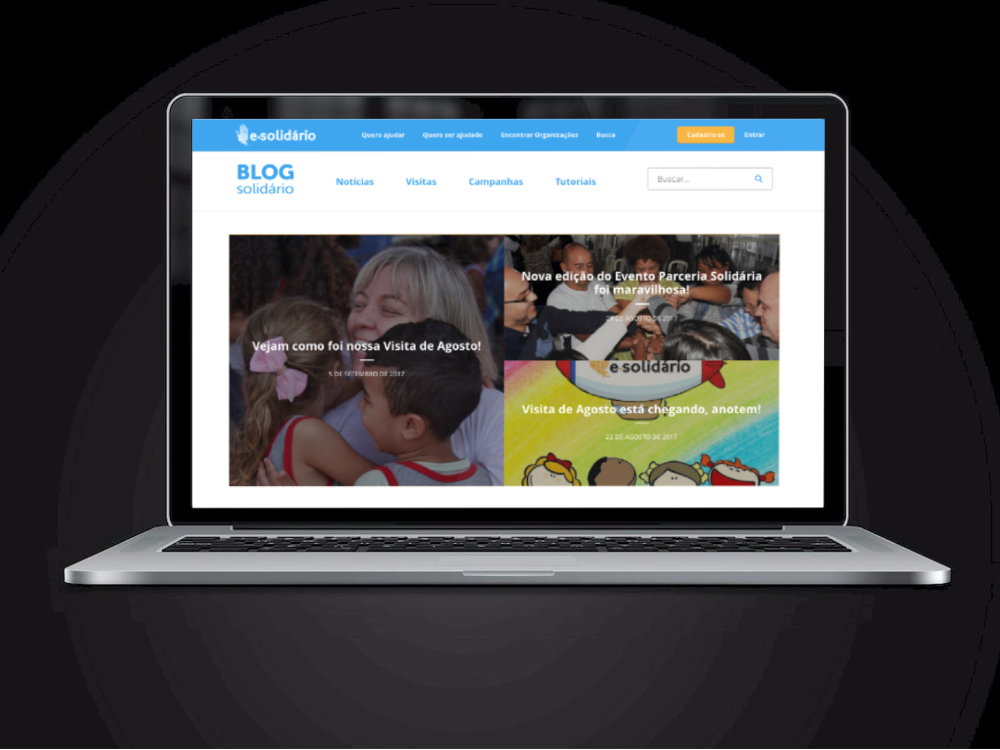

E-Solidário is a Brazilian platform that helps people discover and connect to local NGOs. Through E-Solidário, anyone can easily make donations, support a project, or volunteer in their city. 

In this pro-bono project from Huge, I worked as the only product strategist in a team of around 10 people composed by UX designers, visual designers and front-end developers.

<strong>The problem</strong>

After going through a <a href="http://www.hugeinc.com/case-study/e-solidario">complete redesign</a>, the main challenge for E-Solidário was to grow their presence and become the go-to place for anyone willing to help a social organization in Brazil. As a small nonprofit organization, this also had to be accomplished with minimal resources.

<strong>User research</strong>

Doing guerrilla user research helped us quickly understand important factors about how people decide to make donations. While many people are enthusiastic about the idea of helping social organizations, only a few of them actually do it. 

When talking to users, we found out that they are more likely to help an institution when they <ins>trust it</ins> and feel <ins>emotionally connected</ins> to who they are helping. 

<strong>Strategy</strong>

To reach the business needs, our approach was to focus on organic growth and on bringing credibility to users. To materialize this, we decided to work on:
- <strong>A brand new blog:</strong> We surfaced real success stories enabled by E-Solidário, letting users know the institutions better and encouraging them to see open donation opportunities.
- <strong>SEO best practices:</strong> To improve E-Solidário's organic presence, we worked on content optimization for relevant keywords, implementing meta tags, and link building.
- <strong>Quick wins:</strong> Continuous improvements to the website for increasing trust and encouraging social media sharing.
- <strong>Measurement plan:</strong> Finally, to enable tracking the impact of these actions, we developed a measurement plan with main KPIs and a prioritized analytics implementation guide.

To see this project live, visit E-Solidário's <a href="http://www.e-solidario.com.br/blog/"> blog</a> and <a href="http://www.e-solidario.com.br">website </a>.