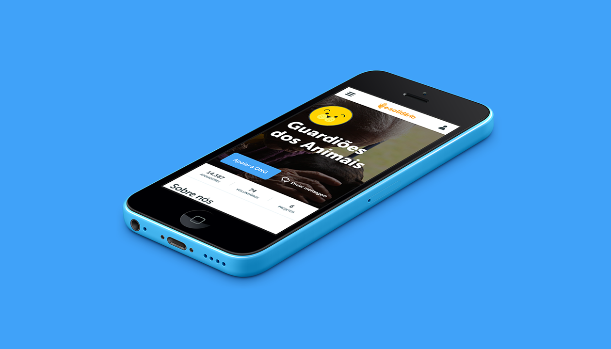
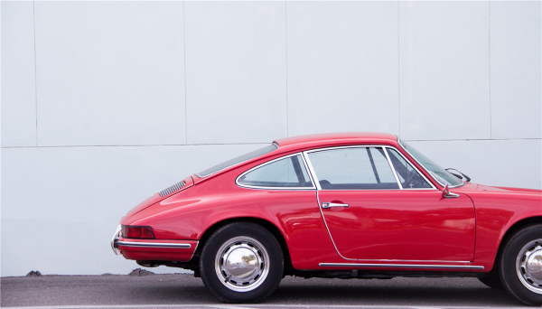
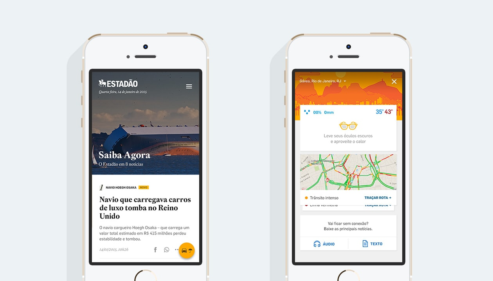

<a href="/projects/e-solidario/">
 
E-Solidário
</a>

<a href="/projects/sportse/">
 
Sportse
</a>

<a href="/projects/car-selector/">
 
Car selector
</a>

<a href="/projects/estadao/">
 
Estadão
</a>

