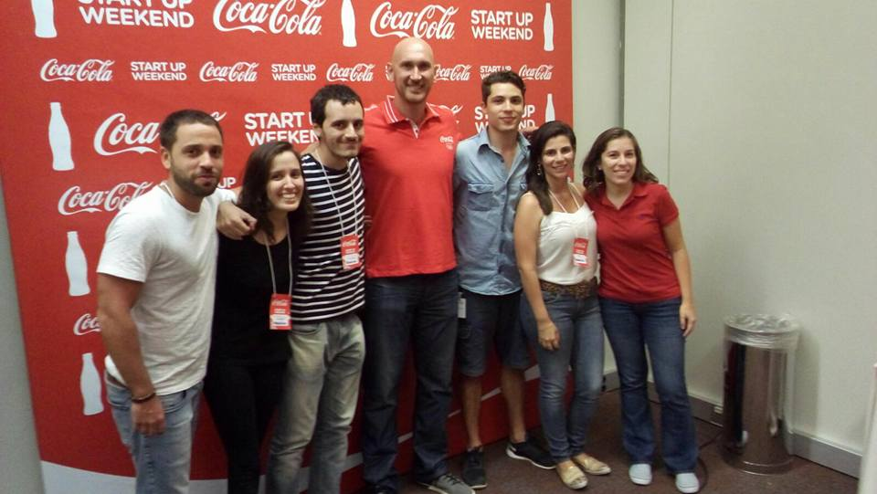
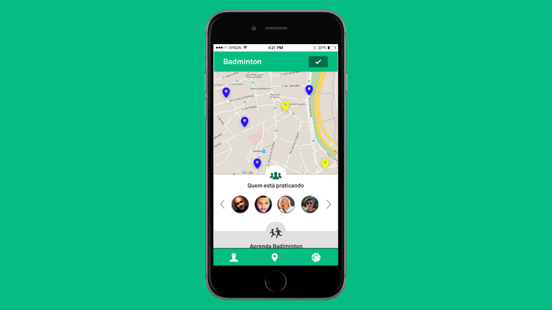

Sportse was a startup I created during a Startup Weekend in Rio, my hometown. I pitched the idea, put a team together, and worked hard for 54h to validate an idea and develop a prototype. Our startup won the 1st place award, and later we continued to work on Sportse's MVP as a side project for a couple of months. 

<strong>The idea</strong>

It all started with a problem that I faced myself: trying to start practicing badminton in a country where everyone just talks about football. Even thought Rio is a big city, I simply didn't know anyone who played badminton, and this was stopping me from learning it.

That's how the initial idea for Sportse was born: a platform where you could find other people to practice any sport, according to your own skills and goals.

<strong>Problem validation</strong>

Going out of the building and talking to as many people as we could in a few hours helped us better understand the problem we were tackling. As we heard from our potential users, getting into a niche sport was especially difficult: you need to search for associations or instructors, call strangers, and sometimes you don't even know if you will be able to afford the cost of practicing it. And for those who already had practiced a sport before, finding partners with similar skills and a compatible schedule was the main pain point.

<strong>The solution</strong>

We envisioned Sportse as a platform with 2 core components: partners and activities, and they helped people practice sports in a complementary way. 
- <strong>Activities:</strong> For those curious about a new sport, going to an activity nearby was the perfect way to get familiar with it and integrate with its community. Activities could be organized by individuals for free, or by companies wanting to promote their brand.
- <strong>Partners: </strong>For those wanting someone to practice with, finding a partner was easy. You add your skills and available schedule, and Sportse matches you with potential partners around you. Professional instructors could also subscribe to Sportse and be featured as expert partners for a sport.

<strong>MVP</strong>

Based on our ambitious vision for Sportse, we scoped our MVP to simply list existing activities for a small set of niche sports in Rio de Janeiro. To do so, we mapped real existing sport activities in the city and used a free website builder to consolidate relevant information about classes, regular practice groups and events. The MVP is actually still live <a href="http://sportse-dev.webflow.io/">here</a>.

<strong>The outcome</strong>

There are a couple of reasons why we decided to archive Sportse, but it was definitely a great learning experience for all of us. I learnt a lot about the importance of launching fast instead of crafting the perfect product, and how a great team can make a great project. 